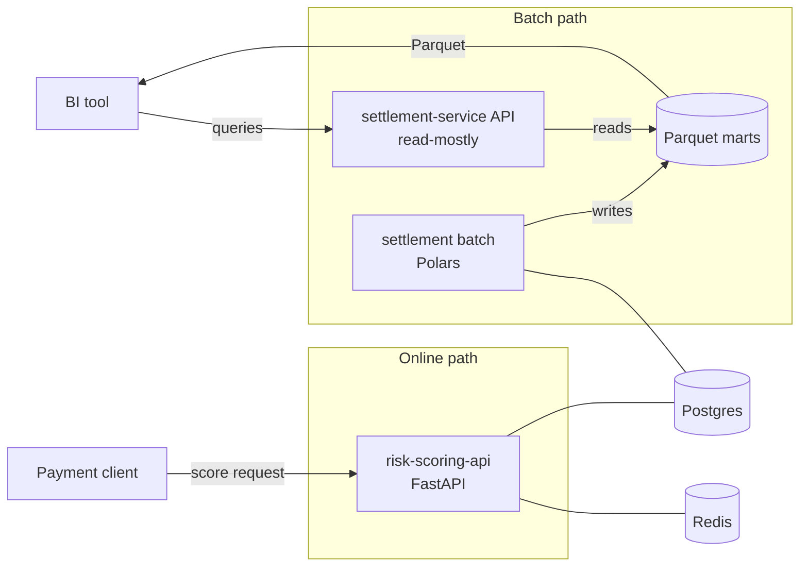

# payments-ml-data-lab


<!-- Replace OWNER with the GitHub account or organisation once the repo is published. -->

A portfolio monorepo that models the two sides of a payments system with entirely synthetic data:
**`risk-scoring-api`**, an online fraud-scoring service (FastAPI, with a LightGBM baseline and a PyTorch
model planned), and **`settlement-service`**, a batch settlement and reconciliation pipeline (Polars)
with a read-mostly API that exposes results to BI. Both live in one uv workspace and share a small
library, with CI, Docker and Compose working from day one. The project is built in phases (see the
[roadmap](#roadmap)). Today both services answer `GET /health`, their v1 API contracts are defined (the
`/v1` routes answer `501`), and a deterministic generator produces one synthetic universe for both:
labeled transactions for the risk side, and a ledger and PSP file with known injected breaks for the
settlement side.

## Architecture (target)



More detail in [`docs/architecture.md`](docs/architecture.md).

## Quickstart

Requirements: [uv](https://docs.astral.sh/uv/) and, for the stack, Docker with Compose. uv installs
Python 3.12 (pinned in `.python-version`) if you do not have it.

```bash
make sync     # install all workspace packages and dev tools
make test     # run the tests of every member
make lint     # ruff check + format check
make up       # build and start postgres, redis and both APIs
```

Check that the services are alive:

```bash
curl localhost:8001/health   # risk-scoring-api
# {"status":"ok","service":"risk-scoring-api","version":"0.1.0"}

curl localhost:8002/health   # settlement-service
# {"status":"ok","service":"settlement-service","version":"0.1.0"}
```

Stop everything with `make down`. Configuration comes from environment variables; copy
`.env.example` to `.env` to change the defaults (`.env` is never committed).

### Synthetic data

```bash
make data-sample                                  # refresh the committed sample in data/samples (~250 KB)
make data-full                                    # about 500k transactions into data/out/full (ignored by git)
make data-validate DIR=data/out/full              # contracts, foreign keys, cross-dataset invariants
```

`data-full` takes a couple of seconds. Every run with the same seed gives the same data. The flags
(`--seed`, `--days`, `--fraud-rate`, `--break-rate`, ...) are listed by
`uv run python -m payments_datagen generate --help`. What is in the data: [`docs/data-model.md`](docs/data-model.md)
and [`docs/fraud-patterns.md`](docs/fraud-patterns.md).

### API contracts

```bash
make contracts          # export the OpenAPI documents to contracts/openapi/
make contracts-check    # fail if the committed documents differ from the code (runs in CI)
```

The `/v1` routes of both services are stubs that answer `501`. Browse `/docs` of a running service to
see the full contract.

### Running the APIs without Docker

```bash
make run-risk             # http://localhost:8001
make run-settlement-api   # http://localhost:8002
```

### Running the settlement batch

The batch is a stub for now: it validates the date, logs the request and exits 0.

```bash
# locally
uv run python -m settlement.batch run --date 2026-11-10

# with Compose (profile "batch": not started by `make up`)
SETTLEMENT_RUN_DATE=2026-11-10 docker compose run --rm settlement-batch

# with the image directly: same image as the API, different command
docker build -f services/settlement-service/Dockerfile -t settlement-service .
docker run --rm settlement-service python -m settlement.batch run --date 2026-11-10
```

## Repository layout

```
.
├── packages/
│   ├── shared/              # payments-shared: schemas, logging, data-contract loader and validator
│   └── datagen/             # payments-datagen: deterministic synthetic data generator (CLI)
├── services/
│   ├── risk-scoring-api/    # online fraud scoring (api, serving, training)
│   └── settlement-service/  # batch + api around a shared domain (domain, batch, api, storage)
├── data/
│   ├── samples/             # committed output of the `sample` profile
│   └── out/                 # local runs (ignored by git)
├── contracts/
│   ├── data/                # YAML data contracts (source of truth)
│   ├── openapi/             # generated from the apps, checked in CI
│   └── examples/            # example payloads, validated by tests
├── scripts/                 # export_openapi.py
├── docs/
│   ├── architecture.md
│   ├── data-model.md        # ER diagram and notes on keys, units and the due-date cutoff
│   ├── fraud-patterns.md    # patterns, hard negatives, label delay and bias
│   └── adr/                 # architecture decision records
├── docker-compose.yml
├── Makefile
└── pyproject.toml           # uv workspace root + shared ruff/pytest config
```

Each service has its own `pyproject.toml` and `Dockerfile`; the build context for images is the repo
root because the workspace and the single `uv.lock` are needed.

## Decisions

- [ADR 0001: Monorepo with a uv workspace](docs/adr/0001-monorepo-with-uv-workspace.md)
- [ADR 0002: settlement-service has `batch` and `api` modules](docs/adr/0002-settlement-service-batch-and-api-modules.md)
- [ADR 0003: `payments-datagen` as a workspace package, one shared universe](docs/adr/0003-datagen-workspace-package-and-single-universe.md)
- [ADR 0004: Contract-first, YAML data contracts and generated OpenAPI](docs/adr/0004-contract-first-with-yaml-data-contracts-and-generated-openapi.md)
- [ADR 0005: Money is an integer in minor units](docs/adr/0005-money-as-integer-minor-units.md)
- [ADR 0006: v1 scoring takes precomputed behavior features](docs/adr/0006-v1-scoring-takes-precomputed-behavior-features.md)

## Roadmap

- [x] **Phase 1: Foundation.** Workspace, shared package, both service skeletons with `/health`,
  Dockerfiles, Compose, CI, Makefile, docs.
- [x] **Phase 2: Data generators and contracts.** Data contracts, v1 API contracts with exported OpenAPI,
  a deterministic generator for one shared universe, a committed sample, validation and CI checks.
- [ ] **Phase 3: risk-scoring-api.** Features, LightGBM baseline, PyTorch model, online scoring endpoint.
- [ ] **Phase 4: settlement-service.** Domain rules, Polars batch pipeline, Parquet marts, read API for BI.
- [ ] **Phase 5: Polish.** Observability, performance notes, documentation pass, demo script.

## License

No license has been chosen yet.
