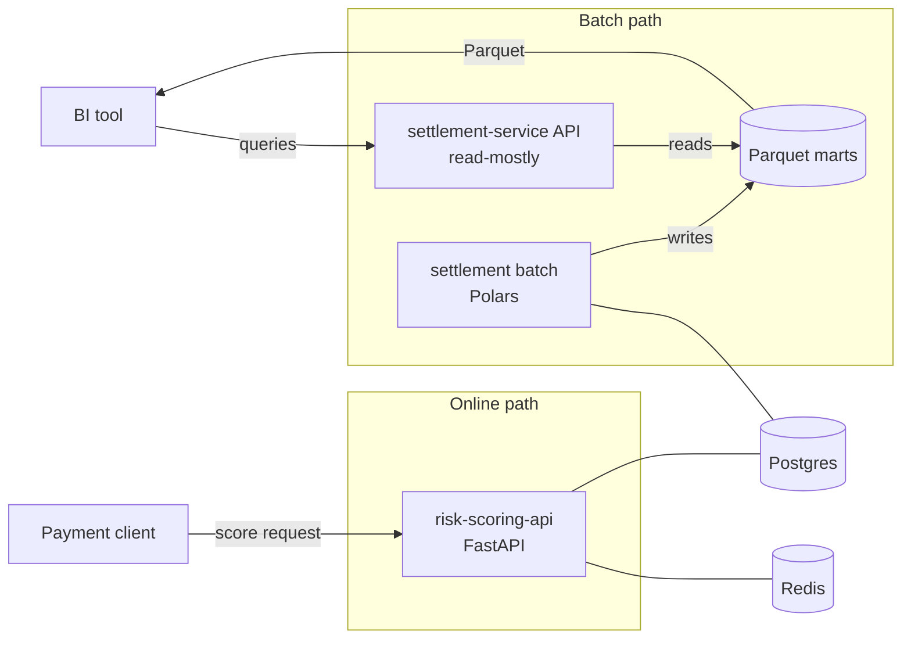

# payments-ml-data-lab


<!-- Replace OWNER with the GitHub account or organisation once the repo is published. -->

A portfolio monorepo that models the two sides of a payments system with entirely synthetic data:
**`risk-scoring-api`**, an online fraud-scoring service (FastAPI, a PyTorch MLP with embeddings, an
idempotent decision log in Postgres), and **`settlement-service`**, a batch settlement and
reconciliation pipeline (Polars) with a read-mostly API that exposes results to BI. Both live in one
uv workspace and share a small library, with CI, Docker and Compose working from day one. The project
is built in phases (see the [roadmap](#roadmap)). Today the risk-scoring service works end to end
(features, training, evaluation, serving, decision log), and so does the settlement service (a Polars
reconciliation pipeline verified against the generator's answer key, Hive-partitioned Parquet marts, a
Postgres-backed run queue with a worker, and a read API for BI); and a deterministic generator produces one synthetic universe for both: labeled
transactions for the risk side, and a ledger and PSP file with known injected breaks for the
settlement side.

> **Everything here is synthetic.** The model is trained on this repository's own generator, so its
> metrics say nothing about real-world fraud performance.

## Architecture (target)



More detail in [`docs/architecture.md`](docs/architecture.md).

## Quickstart

Requirements: [uv](https://docs.astral.sh/uv/) and, for the stack, Docker with Compose. uv installs
Python 3.12 (pinned in `.python-version`) if you do not have it.

```bash
make sync     # install all workspace packages and dev tools
make test     # run the tests of every member
make lint     # ruff check + format check
make up       # build and start postgres, redis, the migrations, both APIs and the settlement worker
```

An existing Postgres volume from before Phase 3 needs a one-time `docker compose down -v`, so the
init script can create the `risk_scoring` and `settlement` databases.

Check that the services are alive:

```bash
curl localhost:8001/ready    # risk-scoring-api: 200 once the model is loaded (/health is liveness only)
# {"status":"ready","model_version":"mlp-2026.11.1"}

curl localhost:8002/health   # settlement-service
# {"status":"ok","service":"settlement-service","version":"0.1.0"}
```

Stop everything with `make down`. Configuration comes from environment variables; copy
`.env.example` to `.env` to change the defaults (`.env` is never committed).

### Synthetic data

```bash
make data-sample                                  # refresh the committed sample in data/samples (~250 KB)
make data-full                                    # about 500k transactions into data/out/full (ignored by git)
make data-validate DIR=data/out/full              # contracts, foreign keys, cross-dataset invariants
```

`data-full` takes a couple of seconds. Every run with the same seed gives the same data. The flags
(`--seed`, `--days`, `--fraud-rate`, `--break-rate`, ...) are listed by
`uv run python -m payments_datagen generate --help`. What is in the data: [`docs/data-model.md`](docs/data-model.md)
and [`docs/fraud-patterns.md`](docs/fraud-patterns.md).

### Risk scoring: train, serve, try it

```bash
make train-risk VERSION=mlp-2026.11.1   # needs data/out/full (make data-full); a few seconds on a CPU
make promote-model VERSION=mlp-2026.11.1  # copy the run to services/risk-scoring-api/models/current
make bench-risk                         # in-process latency: 1,000 single requests, p50 / p95
make up && make demo-score              # scores sample rows, a batch, a replay and a 409
make test-db                            # SQL tests of the decision log, against a throwaway Postgres
```

`models/current/` is committed (about 50 KB), so the service works right after cloning. How a request
flows, how skew is prevented, the idempotency rules and what a caller should do on a timeout are in
[`docs/risk-scoring.md`](docs/risk-scoring.md); the model's intended use and limits are in the
[model card](docs/model-card.md).

**Results** of `mlp-2026.11.1` on the `full` profile (seed 42), time-based split, **synthetic data**:

| | train | validation | test |
| --- | --- | --- | --- |
| rows | 263,054 | 77,210 | 159,402 |
| label rate (prevalence = PR-AUC of a random classifier) | 0.485% | 0.433% | 0.538% |
| PR-AUC | 0.506 | 0.449 | 0.464 (86x prevalence) |
| ROC-AUC | 0.997 | 0.996 | 0.995 |
| recall at FPR 1% / 0.1% | 98.1% / 24.3% | 95.5% / 19.5% | 95.0% / 16.7% |

PR-AUC looks modest next to ROC-AUC because about half of the real fraud has no chargeback label and
counts as a false positive: in the decline band precision is 50% against the labels and 99.8% against
the ground truth. That is the selection bias of label-based training, discussed in the model card
and [ADR 0008](docs/adr/0008-label-maturity-temporal-split-and-selection-bias.md). There is no baseline
model yet on purpose; gradient boosting is the usual strong baseline for tabular fraud data and an
intentional future extension ([ADR 0007](docs/adr/0007-mlp-with-embeddings-and-one-feature-pipeline.md)).

### API contracts

```bash
make contracts          # export the OpenAPI documents to contracts/openapi/
make contracts-check    # fail if the committed documents differ from the code (runs in CI)
```

The `/v1` routes of both services are implemented. Browse `/docs` of a running service to see the
full contract.

### Running the APIs without Docker

```bash
make run-risk             # http://localhost:8001 (needs Postgres: `docker compose up -d postgres`
                          # and `make migrate-risk`)
make run-settlement-api   # http://localhost:8002
```

### Settlement: reconcile, verify, serve

```bash
make settle-all DATA=data/out/full      # reconcile every date of the PSP file in one pass (about 3 s)
make verify-settlement DATA=data/out/full  # compare with the generator's answer key: 100% or non-zero exit
make bench-settlement                   # one date vs the whole range, and the size of the marts
make up && make demo-settlement DATE=2026-01-20   # POST a run, a worker executes it, page, export, replay
make settle-run DATE=2026-01-15         # ops path: one date, bypassing the queue (DATA=, MARTS=)
```

The marts land in `data/marts/` (ignored by git) as Hive-partitioned Parquet, so DuckDB or any BI tool
can query them directly: see [`docs/bi-access.md`](docs/bi-access.md). Rules, break taxonomy, mart
semantics, the run lifecycle and the verification are in [`docs/settlement.md`](docs/settlement.md).
With Compose the worker settles the dataset mounted from `DATASET_DIR` (default `./data/samples`):

```bash
DATASET_DIR=./data/out/full docker compose up -d      # the worker now reads the full dataset
docker compose run --rm settlement-batch              # ad-hoc run that bypasses the queue
```

**Results** on the `full` dataset (seed 42, 499,666 transactions, 180 days). The reconciliation of every
break type matches the generator's answer key exactly:

| Break type | Injected | Found | Precision | Recall |
| --- | --- | --- | --- | --- |
| `AMOUNT_MISMATCH` | 2,228 | 2,228 | 100% | 100% |
| `MISSING_IN_PSP` | 1,753 | 1,753 | 100% | 100% |
| `MISSING_IN_LEDGER` | 1,425 | 1,425 | 100% | 100% |
| `DUPLICATE_IN_PSP` | 1,395 | 1,395 | 100% | 100% |
| `FEE_MISMATCH` | 1,357 | 1,357 | 100% | 100% |
| `CHARGEBACK_NOT_IN_LEDGER` | 914 | 914 | 100% | 100% |

| Performance | |
| --- | --- |
| one date (with input validation) | 0.18 s |
| all 180 dates, one pass, with validation | 2.9 s |
| rows: daily settlement / fee summary / breaks | 34,057 / 33,762 / 9,072 |
| marts on disk (540 partitions) | 2.9 MiB |
| total expected payout | R$ 106,043,163.63 (10,604,316,363 centavos) |

These numbers come from a laptop CPU and *synthetic* data.

## Repository layout

```
.
├── packages/
│   ├── shared/              # payments-shared: schemas, logging, data-contract loader and validator
│   └── datagen/             # payments-datagen: deterministic synthetic data generator (CLI)
├── services/
│   ├── risk-scoring-api/    # online fraud scoring (api, serving, training, persistence, migrations,
│   │                        #   models/current = the promoted model artifact)
│   └── settlement-service/  # domain, batch (pipeline, worker, verification), storage, persistence, api
├── data/
│   ├── samples/             # committed output of the `sample` profile
│   └── out/                 # local runs (ignored by git)
├── contracts/
│   ├── data/                # YAML data contracts (source of truth)
│   ├── openapi/             # generated from the apps, checked in CI
│   └── examples/            # example payloads, validated by tests
├── docker/postgres/init/    # creates the risk_scoring and settlement databases
├── scripts/                 # export_openapi.py, score_sample.py, bench_risk.py, demo_settlement.py,
│                            #   bench_settlement.py
├── docs/
│   ├── architecture.md
│   ├── data-model.md        # ER diagram and notes on keys, units and the due-date cutoff
│   ├── fraud-patterns.md    # patterns, hard negatives, label delay and bias
│   ├── risk-scoring.md      # the online path, skew, idempotency, bands, failure behavior
│   ├── settlement.md        # rules, reconciliation taxonomy, marts, run lifecycle, verification
│   ├── bi-access.md         # querying the marts with DuckDB (the queries are tested)
│   ├── model-card.md        # intended use, data, metrics, limitations, ethics
│   └── adr/                 # architecture decision records
├── docker-compose.yml
├── Makefile
└── pyproject.toml           # uv workspace root + shared ruff/pytest config
```

Each service has its own `pyproject.toml` and `Dockerfile`; the build context for images is the repo
root because the workspace and the single `uv.lock` are needed.

## Decisions

- [ADR 0001: Monorepo with a uv workspace](docs/adr/0001-monorepo-with-uv-workspace.md)
- [ADR 0002: settlement-service has `batch` and `api` modules](docs/adr/0002-settlement-service-batch-and-api-modules.md)
- [ADR 0003: `payments-datagen` as a workspace package, one shared universe](docs/adr/0003-datagen-workspace-package-and-single-universe.md)
- [ADR 0004: Contract-first, YAML data contracts and generated OpenAPI](docs/adr/0004-contract-first-with-yaml-data-contracts-and-generated-openapi.md)
- [ADR 0005: Money is an integer in minor units](docs/adr/0005-money-as-integer-minor-units.md)
- [ADR 0006: v1 scoring takes precomputed behavior features](docs/adr/0006-v1-scoring-takes-precomputed-behavior-features.md)
- [ADR 0007: An MLP with embeddings, one feature pipeline, no baseline yet](docs/adr/0007-mlp-with-embeddings-and-one-feature-pipeline.md)
- [ADR 0008: Label maturity, temporal split and selection bias](docs/adr/0008-label-maturity-temporal-split-and-selection-bias.md)
- [ADR 0009: Serving concurrency, idempotent decision log, ports and adapters](docs/adr/0009-serving-concurrency-idempotent-decision-log-and-ports.md)
- [ADR 0010: Reconciliation algorithm, taxonomy and ground truth kept apart](docs/adr/0010-reconciliation-algorithm-taxonomy-and-ground-truth.md)
- [ADR 0011: Hive-partitioned Parquet marts, atomic overwrite, empty partitions, exports](docs/adr/0011-hive-partitioned-parquet-marts-atomic-overwrite-and-exports.md)
- [ADR 0012: DB-backed queue with SKIP LOCKED, API/worker split, idempotent pipeline](docs/adr/0012-db-backed-queue-skip-locked-and-idempotent-pipeline.md)

## Roadmap

- [x] **Phase 1: Foundation.** Workspace, shared package, both service skeletons with `/health`,
  Dockerfiles, Compose, CI, Makefile, docs.
- [x] **Phase 2: Data generators and contracts.** Data contracts, v1 API contracts with exported OpenAPI,
  a deterministic generator for one shared universe, a committed sample, validation and CI checks.
- [x] **Phase 3: risk-scoring-api.** Shared feature pipeline, label maturity and temporal splits, a
  PyTorch MLP with embeddings, evaluation report and model card, online scoring with an idempotent
  decision log (Postgres, Alembic). No baseline model yet: a gradient-boosting baseline is a planned extension.
- [x] **Phase 4: settlement-service.** Domain rules, Polars reconciliation verified against the
  generator's ground truth, Hive-partitioned Parquet marts, a DB-backed run queue with a worker, a read
  API for BI.
- [ ] **Phase 5: Polish.** Observability, performance notes, documentation pass, demo script.

## License

No license has been chosen yet.
