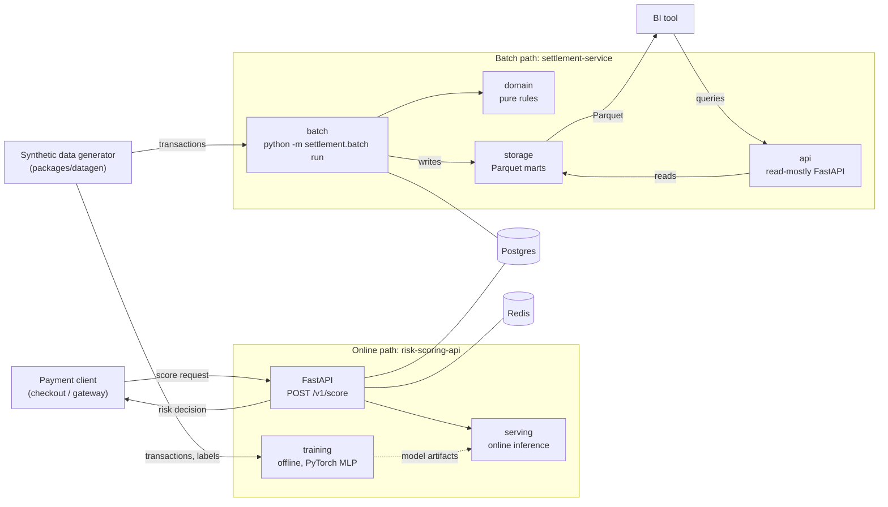

# Architecture

> Status: Phases 1 to 4 are done: the synthetic data generator, the data and API contracts, a working
> `risk-scoring-api` (PyTorch model, idempotent decision log in Postgres; see
> [risk-scoring.md](risk-scoring.md)) and a working `settlement-service` (reconciliation pipeline,
> Parquet marts, a Postgres-backed run queue with a worker, and a read API; see
> [settlement.md](settlement.md)). Redis is provisioned but unused so far. What remains is tracked in
> the roadmap in the [README](../README.md).

The repository models the two sides of a payments system with synthetic data:

- an **online** side that must answer in milliseconds (is this payment risky?), and
- a **batch** side that runs on a schedule and reconciles money (did every payment settle correctly?).

## System overview

Postgres and Redis are provisioned in Compose from phase 1 so later phases can use them. What
each one stores is decided when the first feature needs it.

## Two execution modes

The same split applies to both services: one side is **online** (a long-running API answering
requests), the other is **offline/batch** (a short-lived process that works on a lot of data and
exits). They are separated on purpose, because they have different latency, scaling and failure
requirements.

### risk-scoring-api

| Mode | Package | What it does |
| --- | --- | --- |
| Online | `risk_scoring.api`, `risk_scoring.serving` | Serves scoring requests with a loaded model. Low latency, always running. |
| Offline | `risk_scoring.training` | Trains and evaluates a PyTorch MLP on synthetic data and produces a versioned, hash-verified model artifact. Runs on demand (`make train-risk`). |

Training is offline and serving is online; the model artifact is the hand-off between them, and both
sides use the same feature pipeline so they cannot drift ([ADR 0007](adr/0007-mlp-with-embeddings-and-one-feature-pipeline.md)).
Heavy ML dependencies belong to this service only (see [ADR 0001](adr/0001-monorepo-with-uv-workspace.md)).
Serving keeps an idempotent decision log in Postgres ([ADR 0009](adr/0009-serving-concurrency-idempotent-decision-log-and-ports.md)).

### settlement-service

| Mode | Package | What it does |
| --- | --- | --- |
| Batch | `settlement.batch` | `python -m settlement.batch run --date YYYY-MM-DD`: settles and reconciles one business date with Polars and writes Parquet marts. |
| API | `settlement.api` | Read-mostly FastAPI that exposes the marts' results to BI and other consumers. |

Both modes share `settlement.domain` (pure rules, no Polars/FastAPI/storage imports) and meet in
`settlement.storage`: the Parquet marts are the contract between them. See
[ADR 0002](adr/0002-settlement-service-batch-and-api-modules.md).

The same Docker image runs both modes: the default command starts the API, and the batch is started
by overriding the command (`docker compose run --rm settlement-batch`).

## Data and contracts

`packages/datagen` generates one deterministic universe from a seed: transactions with fraud labels for
the risk side, and the ledger and PSP file derived from those same transactions for the settlement
side, with a known set of injected reconciliation breaks. See [data-model.md](data-model.md) and
[fraud-patterns.md](fraud-patterns.md).

## Shared code

`packages/shared` (`payments_shared`) holds what the services and the generator need: the
`HealthResponse` and `ProblemDetails` schemas, `configure_logging()`, the data-contract loader and
validator, and the RFC 7807 helpers (problem `type` values are `urn:problem:<slug>`). It should stay small; domain logic belongs in the service that owns it.

## Contracts

Anything that crosses a boundary (HTTP APIs, Parquet marts, example payloads) is documented under
[`contracts/`](../contracts/README.md).
