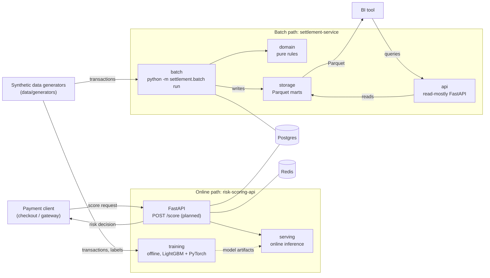

# Architecture

> Status: **target architecture**. Phase 1 (foundation) is done: both services answer
> `GET /health`, and Postgres and Redis run in Compose. Everything else below is planned and is
> tracked in the roadmap in the [README](../README.md).

The repository models the two sides of a payments system with synthetic data:

- an **online** side that must answer in milliseconds (is this payment risky?), and
- a **batch** side that runs on a schedule and reconciles money (did every payment settle correctly?).

## System overview

Postgres and Redis are provisioned in Compose from phase 1 so later phases can use them. What
each one stores is decided when the first feature needs it.

## Two execution modes

The same split applies to both services: one side is **online** (a long-running API answering
requests), the other is **offline/batch** (a short-lived process that works on a lot of data and
exits). They are separated on purpose, because they have different latency, scaling and failure
requirements.

### risk-scoring-api

| Mode | Package | What it does |
| --- | --- | --- |
| Online | `risk_scoring.api`, `risk_scoring.serving` | Serves scoring requests with a loaded model. Low latency, always running. |
| Offline | `risk_scoring.training` | Trains and evaluates models (LightGBM baseline, then PyTorch) on synthetic data and produces model artifacts. Runs on demand. |

Training is offline and serving is online; the model artifact is the hand-off between them. Heavy ML
dependencies belong to this service only (see [ADR 0001](adr/0001-monorepo-with-uv-workspace.md)).

### settlement-service

| Mode | Package | What it does |
| --- | --- | --- |
| Batch | `settlement.batch` | `python -m settlement.batch run --date YYYY-MM-DD`: settles and reconciles one business date with Polars and writes Parquet marts. |
| API | `settlement.api` | Read-mostly FastAPI that exposes the marts' results to BI and other consumers. |

Both modes share `settlement.domain` (pure rules, no Polars/FastAPI/storage imports) and meet in
`settlement.storage`: the Parquet marts are the contract between them. See
[ADR 0002](adr/0002-settlement-service-batch-and-api-modules.md).

The same Docker image runs both modes: the default command starts the API, and the batch is started
by overriding the command (`docker compose run --rm settlement-batch`).

## Shared code

`packages/shared` (`payments_shared`) holds what both services need: the `HealthResponse` schema and
`configure_logging()`. It should stay small; domain logic belongs in the service that owns it.

## Contracts

Anything that crosses a boundary (HTTP APIs, Parquet marts, example payloads) is documented under
[`contracts/`](../contracts/README.md).
