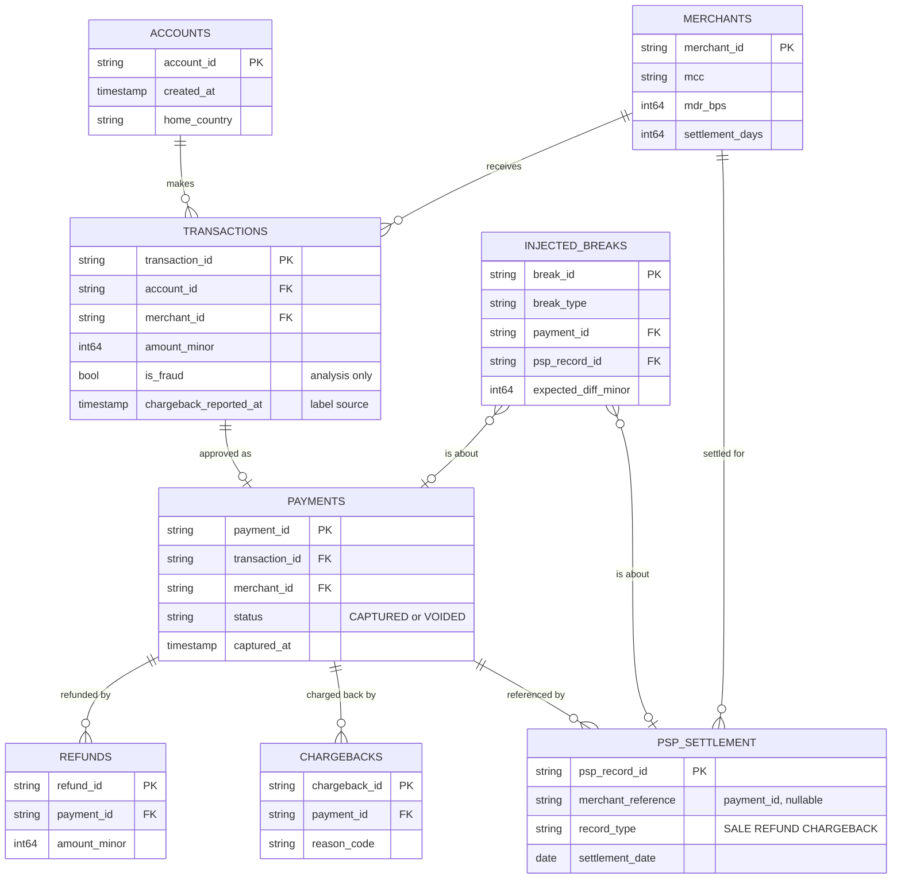

# Data model

All data is synthetic and comes from one deterministic universe (see
[ADR 0003](adr/0003-datagen-workspace-package-and-single-universe.md)). Each dataset has a
[data contract](../contracts/data/) that is the source of truth for columns, types and rules; this page
explains how the datasets relate and the conventions behind them.

## Entity relationships



The three **marts** (`daily_settlement_by_merchant`, `reconciliation_breaks`, `fee_summary`) are
produced by the settlement batch in phase 4. Only their contracts exist today. They are derived from
`psp_settlement` and the ledger, and are not shown above.

## Datasets

| Dataset | Grain | Primary key | Sorted by |
| --- | --- | --- | --- |
| `merchants` | one per merchant | `merchant_id` | `created_at` |
| `accounts` | one per account | `account_id` | `created_at` |
| `transactions` | one per card transaction *attempt* | `transaction_id` | `occurred_at` |
| `payments` | one per approved transaction | `payment_id` | `authorized_at` |
| `refunds` | one per refund | `refund_id` | `created_at` |
| `chargebacks` | one per chargeback | `chargeback_id` | `opened_at` |
| `psp_settlement` | one per PSP record | `psp_record_id` | `settlement_date` |
| `injected_breaks` | one per injected discrepancy | `break_id` | `break_id` |

On disk, with `--out DIR`: `reference/{merchants,accounts}.parquet`, `risk/transactions.parquet`,
`settlement/{payments,refunds,chargebacks,psp_settlement,injected_breaks}.parquet` and
`manifest.json`. One zstd Parquet file per dataset.

## Conventions

- **Ids** are a prefix and lowercase hex: `acc_` 8, `mer_` 6, `dev_` 10, `txn_` 12, `pay_` 12,
  `ref_` 12, `cbk_` 12, `psp_` 12, `brk_` 8. They are handed out *after* sorting by time or creation, so
  they grow with time.
- **Money is an integer in minor units** (`amount_minor`, centavos), never a float
  ([ADR 0005](adr/0005-money-as-integer-minor-units.md)). The currency is `BRL` only.
- **Timestamps** are UTC with microsecond precision. Country codes are ISO 3166-1 alpha-2. Card BINs
  are 6 digits from a pool of about 40 synthetic BINs (9xxxxx); there are no full card numbers.
- **Everything is synthetic.** Merchant names are generic ("Alder Grocer 0042"), never real brands.

## Hidden state

Two facts are used to derive the data but are **never written**, because they would leak the label:
whether a transaction was *declined* upstream (declined ones never become payments), and whether a
payment was *voided* (the status is visible on the payment, but the decision is not on the
transaction). `transactions` is one row per attempt, so a transaction without a payment was either
declined or does not exist in the ledger.

## Point-in-time features

The behavior features of `transactions` (`txn_count_1h`, `txn_count_24h`, `avg_amount_30d_minor`,
`seconds_since_last_txn`, `device_is_new_for_account`, `card_is_new_for_merchant`) use only the
account's earlier transactions. Windows are half-open `[t - window, t)`, so the current row is never
part of its own features. The 30-day mean is an integer, rounded half up. Declined attempts count,
because the scoring service also sees them. For in-person (`pos`) purchases the device is a terminal,
so `device_is_new_for_account` is always false and there are no IP signals. See
[ADR 0006](adr/0006-v1-scoring-takes-precomputed-behavior-features.md).

## Settlement semantics

**PSP records.** The PSP file is what the provider reports it settled:

| `record_type` | `gross_amount_minor` | `fee_minor` | `net_amount_minor` | `settlement_date` |
| --- | --- | --- | --- | --- |
| `SALE` | payment amount | `round_half_up(gross * mdr_bps / 10000)` | `gross - fee` | capture date + merchant `settlement_days` |
| `REFUND` | refund amount | 0 | `-gross` | refund date + 1 day |
| `CHARGEBACK` | payment amount | 1500 (flat) | `-(gross + fee)` | chargeback date + 1 day |

The expected fee is computed from the record's own gross amount, in integer arithmetic. This
rounding rule belongs to the settlement domain: the phase 4 reconciliation must reproduce it exactly.

**Due-date cutoff.** A record exists in the PSP file only when its `settlement_date` is on or before the
last day of the data window. A captured payment that is not due yet has **no PSP record, and that is
not a break**. Reconciliation must compare only what is due: without this rule every recent payment
would look like a `MISSING_IN_PSP`. The rule applies to sales, refunds and chargebacks alike.

**The ledger** is `payments`, `refunds` and `chargebacks`. A refunded payment stays `CAPTURED`; refunds
are separate rows and add up to at most the payment amount. A charged-back payment is not also
refunded. Only captured payments can be refunded or charged back, and chargebacks may be opened after
the end of the window.

## Injected breaks

The generator corrupts the PSP file in known ways and records each in `injected_breaks`. This is the
answer key for testing the phase 4 reconciliation. At most one break per payment.
`expected_diff_minor` is *PSP minus ledger*.

| `break_type` | What the generator does | `expected_diff_minor` |
| --- | --- | --- |
| `AMOUNT_MISMATCH` | PSP gross differs from the ledger amount (its fee follows its gross) | psp gross - ledger amount |
| `MISSING_IN_PSP` | a due SALE record is left out of the file | -ledger amount |
| `MISSING_IN_LEDGER` | an extra SALE record whose reference is null or unknown | +psp gross |
| `DUPLICATE_IN_PSP` | the same SALE appears twice (new `psp_record_id`) | +duplicate gross |
| `FEE_MISMATCH` | PSP fee differs from the contracted fee | psp fee - expected fee |
| `CHARGEBACK_NOT_IN_LEDGER` | a PSP CHARGEBACK with no ledger chargeback | +psp gross |

## Invariants

`python -m payments_datagen validate DIR` checks, beyond the per-dataset contracts: every foreign key
resolves; one payment per transaction; rows are sorted; FRAUD chargebacks and
`chargeback_reported_at` are the same fact; refunds never exceed payments; every injected break is
visible in the data with the stated difference; every due, captured payment without a PSP sale has a
`MISSING_IN_PSP` break; and nothing else differs between ledger and PSP file (no *unexplained*
discrepancy). It also checks that the same seed gives equal data and another seed does not.

## Regenerating

```bash
make data-sample                                    # refresh the committed sample (data/samples)
uv run python -m payments_datagen generate --profile full --out data/out/full
make data-validate DIR=data/out/full
```
