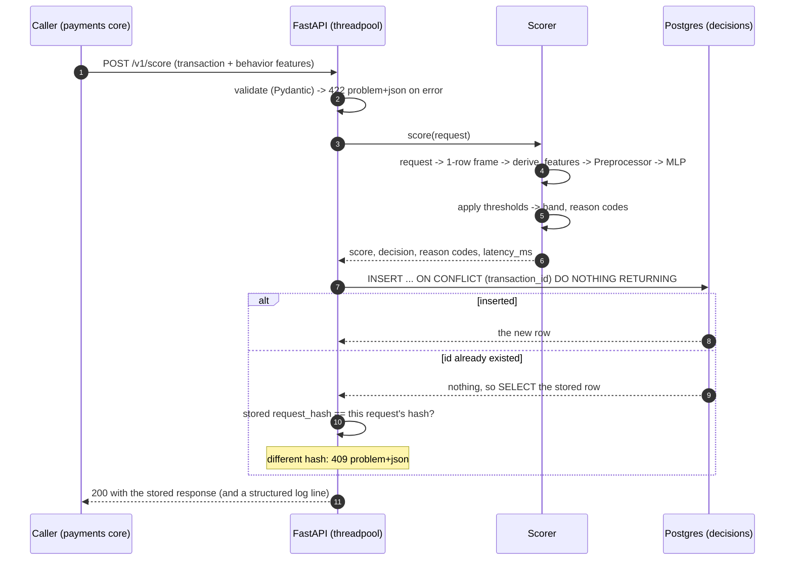

# risk-scoring-api: how it works

> **All data is synthetic.** The model is trained on this repository's own generator. Its metrics
> say nothing about real-world fraud performance (see the [model card](model-card.md)).

The service scores one card transaction at a time, in milliseconds, and keeps a durable log of every
decision. This page follows a request through the service and explains the choices that matter.
The decisions behind it are in ADRs [0007](adr/0007-mlp-with-embeddings-and-one-feature-pipeline.md),
[0008](adr/0008-label-maturity-temporal-split-and-selection-bias.md) and
[0009](adr/0009-serving-concurrency-idempotent-decision-log-and-ports.md).

## The online path



`latency_ms` measures steps 3 to 5 (features plus inference), not parsing, validation or the
database. About 2 ms in process on a laptop CPU (`make bench-risk`); a few milliseconds more through
HTTP, JSON and Postgres.

## No training/serving skew

The classic failure of an ML service is that the model sees different numbers online than it saw
in training, and nothing crashes. Here:

- There is **one function**, `derive_features`, that turns the contract's feature columns into the
  model's derived columns, and one `Preprocessor.transform`. Training calls them on 500,000 rows;
  serving calls them on one row built from the request. There is no "online version".
- The raw input columns are **read from the data contract** (`role: feature` in
  `contracts/data/transactions.yaml`). The artifact stores the columns it was trained on and the
  loader refuses to start if they differ from the current contract.
- `test_no_training_serving_skew` pushes dataset rows through the request path (row, JSON-shaped
  request, validation, frame) and through the training path, and asserts equal raw values, equal
  encodings and equal final scores, for the batch and the single-row call.
- The velocity features (`behavior`) come from the caller in v1 (ADR 0006). The caller must compute
  them **point-in-time**: only past data, the current transaction excluded. That is the one place where
  skew can still enter, and it is outside this service.

## Decision bands

`score` is a **ranking score in [0, 1], not a calibrated probability** (the loss is weighted). The
decision comes from two thresholds chosen on validation data by false-positive rate on legitimate
traffic:

| band | rule | chosen so that |
| --- | --- | --- |
| `APPROVE` | `score < review` | |
| `REVIEW` | `review <= score < decline` | about 2% of legitimate transactions land at or above `review` |
| `DECLINE` | `score >= decline` | about 0.2% of legitimate transactions land at or above `decline` |

The thresholds are stored in the artifact (`GET /v1/model` shows them) and can be overridden with
`RISK_THRESHOLD_REVIEW` and `RISK_THRESHOLD_DECLINE`. Moving them trades manual-review volume against
fraud caught; the model card shows what the current ones do on the test split.

`reason_codes` are **heuristic**: rules over the request (proxy, new device, country mismatch,
amount at least 3x the 30-day average, 5 or more transactions in the last hour, 15 or more in the last
day, account under 30 days old, high-risk MCC, new card for the merchant), at most five, strongest
first, and only for `REVIEW` and `DECLINE`. They are not attributions of the network.

## Idempotency

A payments core retries, so the same `transaction_id` can arrive twice, even at once.

1. The request is scored. Scoring is deterministic, so two racing copies compute the same answer.
2. The decision is inserted with `INSERT ... ON CONFLICT (transaction_id) DO NOTHING`. Exactly one
   caller inserts; any other waits on the unique index and then reads the winner's row.
3. If a row already exists, its `request_hash` (sha256 of the canonical JSON) is compared with this
   request's. **Same hash: `200` with the stored response**, byte for byte, including the original
   `latency_ms` and `model_version`. **Different hash: `409` problem+json**, and the original decision is
   left untouched.

In a batch the same rules apply per item, and a conflict or a validation error becomes that item's
`error` while the rest are scored (one batched forward pass). An item without a usable
`transaction_id` cannot be reported on its own, so it fails the whole request with `422`.

## Failure behavior

| situation | response |
| --- | --- |
| body not valid | `422` `urn:problem:validation-error`, with the field locations |
| same id, other payload | `409` `urn:problem:idempotency-conflict` |
| model missing, tampered or built for other features | the app starts; `/ready` and the scoring routes answer `503` (`urn:problem:not-ready`, `urn:problem:model-unavailable`) |
| decision log unreachable | `503` `urn:problem:decision-log-unavailable`; the decision is not made |
| process alive | `GET /health` is `200` (liveness only) |
| model and thresholds loaded | `GET /ready` is `200` |

`/ready` does not check the database: it answers "can this instance score?" from the loaded
model. A database outage shows up as `503` on scoring; use the Compose `risk-migrate` step and your
own database monitoring for it.

## What a caller should do on a timeout or a 5xx

The scoring call sits in the authorization path, so its failure must never block a payment forever.

- **Set a short, bounded timeout** (for example 100 to 300 ms for the call, with a hard overall
  budget for the authorization) and a small number of retries with jitter. Retries are safe: the
  same `transaction_id` and payload return the same decision.
- **Always send the same `transaction_id` on retry**, and never reuse an id for a different payload
  (that is a `409`).
- **Decide the fallback policy in advance, as a business rule, not in the heat of an outage.** A common
  shape: approve low-amount, known-device payments, send high-amount or new-device payments to a
  conservative rule set or to manual review, and decline only on rules you can justify. "Fail open" and
  "fail closed" are both defensible; an unplanned one is not.
- **Record that the fallback was used** (with the reason), so those payments can be re-scored
  later, and so the gap is visible in reports.
- Treat `503` as retryable and `4xx` (other than `409` on a replay you expected) as a bug in the caller.
- Do not interpret `score` as a percentage, and do not store thresholds in the caller: read
  `decision`.

## Training and promoting a model

```bash
make data-full                                   # data/out/full, about 500k transactions
make train-risk VERSION=mlp-2026.11.1            # training run, evaluation, report (a few seconds)
make eval-risk MODEL=services/risk-scoring-api/models/runs/mlp-2026.11.1   # re-evaluate a run
make promote-model VERSION=mlp-2026.11.1         # copy the run to models/current (committed)
make bench-risk                                  # in-process latency of the promoted model
```

A run writes `model.pt`, `preprocessor.json`, `metadata.json`, `metrics.json` and `report.md` to
`services/risk-scoring-api/models/runs/<version>/` (ignored by git). `models/current/` is the
promoted copy and is committed (about 50 KB), so the service works right after cloning. The version
is passed explicitly: no wall-clock time is baked into it. The report lists the split dates, the
label `as_of`, the hyperparameters, the data manifest, the metrics by split, band, fraud pattern and
feature group, the label coverage, and the sanity guards.

## Running it

```bash
make up            # postgres, redis, risk-migrate (alembic upgrade head), both APIs
make demo-score    # replays sample rows: scores, a batch with a bad item, a replay, a 409
make test-db       # starts Postgres and runs the SQL tests of the decision log
```

An existing Postgres volume from before Phase 3 needs a one-time `docker compose down -v`, so the
init script can create the `risk_scoring` and `settlement` databases.
