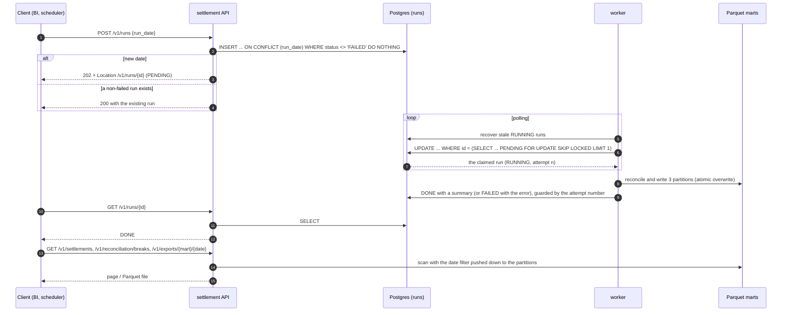

# settlement-service: rules, reconciliation and marts

> **All data is synthetic.** The rules below are the ones the data generator
> (`packages/datagen/src/payments_datagen/settlement.py`) encodes. When a convention is ambiguous the
> generator is the reference for what the data means, and the pipeline mirrors it.

The service has three execution modes that share one image: a **batch pipeline** that reconciles the
ledger against the PSP file and publishes three marts, a **worker** that executes runs queued in
Postgres, and a **read API** for BI. The page covers the rules, the reconciliation, the marts, the run
lifecycle and the verification against the generator's answer key.

## Rules extracted from the generator

### Settlement dates

| Record | Settles on | Where it comes from |
| --- | --- | --- |
| `SALE` | UTC calendar date of `captured_at` + the merchant's `settlement_days` (1, 2 or 30) | `payments` (status `CAPTURED`) joined to `merchants` |
| `REFUND` | UTC date of the refund's `created_at` + 1 day | `refunds` |
| `CHARGEBACK` | UTC date of the chargeback's `opened_at` + 1 day | `chargebacks` |

Only the *date* of the timestamp matters: 23:59:59 and 00:00:01 UTC are different days. The Phase 2
text (`psp_settlement` contract and `docs/data-model.md`) already says this; the generator agrees.
Voided payments (`VOIDED`) never settle: they moved no money.

### Fee

The contracted SALE fee is `round_half_up(gross * mdr_bps / 10000)`, computed as
`(gross * mdr_bps + 5000) // 10000` in integers. A gross of 1050 at 100 bps is exactly 10.5, so the
fee is 11; 1049 gives 10. REFUND records carry no fee. A CHARGEBACK record carries a flat fee of 1500
that the PSP charges the platform. The merchant's terms (`mdr_bps`, `settlement_days`) are static.

### Signs

The PSP file stores `gross_amount_minor` as a positive magnitude and puts the sign in
`net_amount_minor`: `SALE` net = gross - fee, `REFUND` net = -gross, `CHARGEBACK` net =
-(gross + fee). `diff_minor` in a break is always **PSP minus ledger**.

### Due-date cutoff

The PSP file has no record settling after the last day of the data window, and a captured payment that
is not due yet is *not* a break. The pipeline reconciles only the dates it is asked to, and "due on D"
means `settlement_date = D`, so it never compares something before its due date. For a dataset, the
dates to run are those the PSP file covers (`run-range --all` reads them from the file).

### References

The PSP's `merchant_reference` is the `payment_id` the merchant sent. It is null for some orphan
records and, for others, a well-formed id that no payment owns. The matching key is
`(settlement_date, payment_id, record_type)`.

### Conventions the generator fixes (and the pipeline mirrors)

- **Duplicates.** The extra copy of a duplicated SALE gets the *higher* `psp_record_id`: ids are
  handed out after sorting and the original sorts first. So "the lowest `psp_record_id` is the
  original, the others are duplicates" reproduces the ground truth.
- **`payment_id` of a break.** The ground truth has it null for `MISSING_IN_LEDGER` (the PSP record
  has no payment), the payment id for every other type. The pipeline sets it to the PSP reference
  *only if that reference is a known payment*, and to null otherwise, which gives the same answer.
- **`psp_record_id` of a break.** Null for `MISSING_IN_PSP` (nothing to point at); for
  `DUPLICATE_IN_PSP` it is the *duplicate's* id.
- **Several refunds of one payment.** A payment may have two partial refunds, and they can fall on
  the same settlement date (133 of 20,806 refunds in the `full` dataset). The key
  `(date, payment, type)` then has two ledger records and two PSP records, and the PSP file has no
  refund id to tell them apart. The pipeline pairs them by rank (see the reconciliation section)
  instead of calling the second PSP refund a duplicate. This is the one place where the stated rule
  "more than one PSP record per key means duplicates" needed refining; no generator change is needed.

### Differences from the Phase 2 text

- The mart contract `daily_settlement_by_merchant` was described as "aggregated from the PSP
  records". The Phase 4 decision is that it is the **ledger-expected payout** ("what we owe the
  merchant"): the description is corrected. Its `chargebacks_minor` is the chargeback *amounts* only;
  the flat 1500 fee is absorbed by the platform and not deducted from the merchant. The description
  said "plus their flat fees": corrected.
- The `date` of `GET /v1/reconciliation/breaks` is the run date, which equals the settlement date of
  every row of that run.

## Reconciliation

A run for date `D` reconciles everything **due on `D`**: the ledger's expected records against the PSP
records with `settlement_date = D`. The pipeline functions are date-agnostic (they group by
`settlement_date`), so one pass can reconcile many dates; `run --date D` is a list of one date.
Algorithm and its edge cases are in
[ADR 0010](adr/0010-reconciliation-algorithm-taxonomy-and-ground-truth.md) and in the docstring of
`settlement/batch/reconcile.py`.

**Expected side** (`batch/expected.py`): a SALE per `CAPTURED` payment, a REFUND per refund, a CHARGEBACK
per chargeback, each with its due date. **PSP side**: the file's records for the date. **Key**:
`(settlement_date, payment_id, record_type)`; the PSP's `merchant_reference` is the payment id.

### Break taxonomy and amounts

Every discrepancy gets exactly one class, so there is no "unclassified". `diff_minor` is **PSP minus
ledger**.

| Situation | `break_type` | `ledger_amount_minor` | `psp_amount_minor` | `diff_minor` |
| --- | --- | --- | --- | --- |
| More than one PSP record per key (all but the lowest `psp_record_id`) | `DUPLICATE_IN_PSP` | null | the duplicate's gross | + duplicate gross |
| Ledger expected, no PSP record | `MISSING_IN_PSP` | ledger amount | null | - ledger amount |
| PSP record with no ledger counterpart, type CHARGEBACK | `CHARGEBACK_NOT_IN_LEDGER` | null | PSP gross | + PSP gross |
| PSP record with no ledger counterpart, other types | `MISSING_IN_LEDGER` | null | PSP gross | + PSP gross |
| Both present, gross differs | `AMOUNT_MISMATCH` | ledger amount | PSP gross | PSP - ledger |
| Both present, gross equal, SALE, fee differs from the expected fee | `FEE_MISMATCH` | expected fee | PSP fee | PSP - expected |

`AMOUNT_MISMATCH` takes precedence over `FEE_MISMATCH` (when the amount is wrong the fee is wrong
too, and the amount is the root cause). The expected fee uses the *ledger* amount and the merchant's
`mdr_bps`. The fee of a REFUND or a CHARGEBACK is not compared.

`payment_id` and `psp_record_id` of a break follow the conventions in the rules section above. The
`break_id` is `brk_` + 4 hex digits of the day number + 4 hex digits of the sequence within the day:
deterministic, so a rerun gives the same ids, and unique across dates.

### Known limitations

- **No cross-date matching.** A record the PSP settled on a different date than expected shows up as
  `MISSING_IN_PSP` on the expected date and `MISSING_IN_LEDGER` on the other. Late-arriving files are out
  of scope.
- **Same-day multiple refunds are paired by rank** (amount, then id). The PSP file has no refund id,
  so an amount error in one of two same-day refunds of the same payment could be attributed to the
  wrong one. The generator never injects such a break.
- **A single currency (BRL), static merchant terms.** `mdr_bps` and `settlement_days` do not change over time.
- **No payout batching and no double-entry journal.** The mart is a daily expected payout, not a ledger.

## The marts

Three marts, written as Hive-partitioned Parquet:

```
<marts_dir>/<mart>/settlement_date=YYYY-MM-DD/part-0.parquet      (zstd, rows sorted by primary key)
```

| Mart | Grain | What it is |
| --- | --- | --- |
| `daily_settlement_by_merchant` | settlement date, merchant, currency | The **ledger-expected payout**: what the platform owes the merchant, *not* what the PSP confirmed. `gross` = captured payments due that day, `fee` = expected fee, `refunds` and `chargebacks` = amounts due (non-negative magnitudes). `net = gross - fee - refunds - chargebacks`; it can be negative. The flat chargeback fee is absorbed by the platform and not deducted. |
| `fee_summary` | settlement date, merchant, currency | Only SALEs present on both sides **with equal gross**, so a non-zero `fee_diff_minor` isolates fee errors from amount errors. `actual_fee` from the PSP, `fee_diff = actual - expected`. |
| `reconciliation_breaks` | one row per break | The discrepancies above. `run_date` is the date being reconciled and equals `settlement_date`. |

Every mart is validated against its data contract **before** it is published, and a failure fails
the run. A date with nothing to report is written as an **empty partition with the right schema**, so
"the run happened and found nothing" differs from "the run never happened" (the export of the
latter is a `404`). Partitions are replaced atomically: a rerun is idempotent and a failure never
leaves a half-written or missing partition
([ADR 0011](adr/0011-hive-partitioned-parquet-marts-atomic-overwrite-and-exports.md)).

Anyone can query the marts directly, without the API: see [bi-access.md](bi-access.md).

## Runs and the worker

`POST /v1/runs` registers a run in Postgres and returns at once; a **worker** executes it. This keeps
the API fast and lets runs survive restarts
([ADR 0012](adr/0012-db-backed-queue-skip-locked-and-idempotent-pipeline.md)).



States: `PENDING -> RUNNING -> DONE | FAILED`, and `RUNNING -> PENDING` when a stale run is given
back (or `FAILED` once `attempts >= max_attempts`). A partial unique index allows only one run per
date that is not `FAILED`, so requesting a date again returns the same run, and a failed one can be
retried with a new request. Delivery is at-least-once; the pipeline is idempotent, so that is safe.

The direct CLI paths (`run`, `run-range`) bypass the table: they are the ops and backfill route and
are idempotent through the atomic partition overwrite.

## The read API

Reads scan the marts lazily with the date range pushed down to the partitions. Pagination is
**keyset**: the cursor is the opaque, base64url JSON of the last `(settlement_date, merchant_id)` or
`(settlement_date, break_id)`; a malformed or foreign cursor is a `400 urn:problem:invalid-cursor`.
Defaults: `limit` 100, maximum 1,000. Exports return the partition file itself
(`application/vnd.apache.parquet`). `GET /ready` checks the database and the marts directory.

## Verification against the answer key

`python -m settlement.batch verify` compares the `reconciliation_breaks` mart with the generator's
`injected_breaks.parquet` over the dates the marts cover, matching on `(break_type, payment_id,
psp_record_id)` (nulls equal) and comparing `diff_minor` with `expected_diff_minor`. It prints precision
and recall per break type and exits non-zero unless both are 100%. The pipeline never reads
`injected_breaks`: a test deletes the file and runs the pipeline, and another checks statically that
only the verification module names it.

On the `full` dataset (seed 42, 180 days, 499,666 transactions):

| Break type | Injected | Found | Precision | Recall |
| --- | --- | --- | --- | --- |
| `AMOUNT_MISMATCH` | 2,228 | 2,228 | 100% | 100% |
| `MISSING_IN_PSP` | 1,753 | 1,753 | 100% | 100% |
| `MISSING_IN_LEDGER` | 1,425 | 1,425 | 100% | 100% |
| `DUPLICATE_IN_PSP` | 1,395 | 1,395 | 100% | 100% |
| `FEE_MISMATCH` | 1,357 | 1,357 | 100% | 100% |
| `CHARGEBACK_NOT_IN_LEDGER` | 914 | 914 | 100% | 100% |

Same result on the committed sample and on small datasets of three other seeds. Timing and sizes:
`make bench-settlement`.
